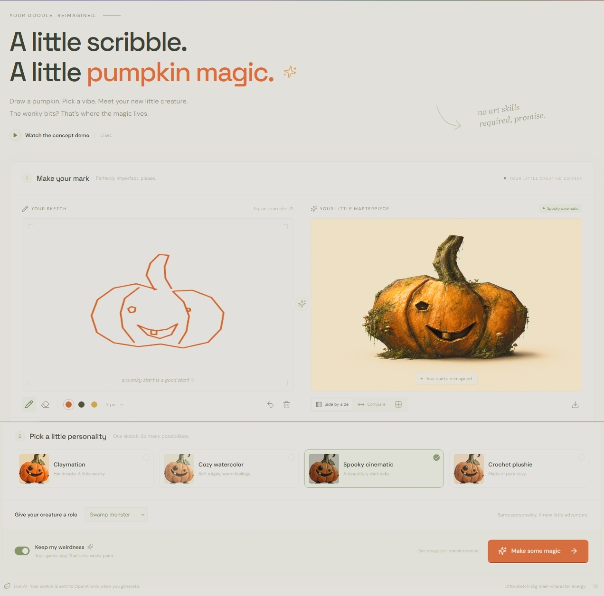

# Pumpkin, Remixed

Draw a pumpkin, choose a visual style and character, and turn the actual sketch into a polished creature with OpenAI image editing. “Keep my weirdness” starts enabled and asks the model to preserve the drawing’s asymmetry, long stems, mismatched eyes, expression, and placement. Results can vary; the model cannot guarantee pixel-perfect preservation.



## Run locally

Requires Node.js 22.22.2+ or 24.15+ on the supported LTS lines (or Node 26+), matching the test tooling’s requirements.

```sh
npm install
cp .env.example .env
# Set OPENAI_API_KEY in .env on the server. Never use a VITE_ prefix for secrets.
npm run dev
```

Open `http://localhost:5173`. The Node server handles `/api` and runs Vite middleware on the same origin. Restart it after changing `.env`. Without a key, the drawing tools and concept demo work and the UI explains why live generation is unavailable.

## Production

```sh
npm ci
npm run build
npm start
```

The same Node server serves `dist/` and the image API. Set environment variables in the deployment environment, or use the ignored `.env` file. Do not deploy only the static `dist/` folder: live generation requires the Node server. `PORT` defaults to `5173`; `HOST` defaults to `0.0.0.0`.

## How the transformation works

1. The client exports the canvas as an opaque 1024 × 1024 PNG. The comparison snapshot uses this exact image.
2. `POST /api/transform` validates the PNG, checks that it contains ink, and validates the selected style, character, and boolean weirdness setting.
3. The server sends the sketch as an image reference to OpenAI’s [image edits endpoint](https://developers.openai.com/api/reference/resources/images/methods/edit), with specific material, costume, composition and preservation instructions. The default model is `gpt-image-2`; override with `OPENAI_IMAGE_MODEL` for an image-editing model your project can access. The API key stays on the server.
4. The returned PNG becomes the actual preview and download. Results are matched to the exact sketch and settings; changing them never silently reuses an unrelated image.

Choose Claymation, Cozy watercolor, Spooky cinematic, or Crochet plushie. Characters include the original pumpkin, tiny knight, swamp monster, space explorer, and elegant aristocrat. Generate styles individually or use the gallery’s **Generate missing styles** button. A fresh four-style gallery makes four sequential provider requests. Completed styles remain available if a later request fails; retry generates only the missing styles.

One transformation runs at a time per server process. `MAX_GENERATIONS_PER_HOUR` defaults to `12` provider attempts shared by the studio; a batch uses one attempt per image. Failures and cancellations count because the provider may already have started processing. The limit resets after an hour or server restart, and is per process rather than distributed. The upstream timeout is three minutes. Cancellation aborts the server’s provider request, but does not guarantee that provider processing or billing stops. Place a publicly deployed studio behind your deployment’s access controls; the app itself does not implement user accounts.

The studio also shares a **60,000-token daily budget** across all users. `GENERATION_MAX_DAILY_TOKENS=60000` counts provider-reported input plus output tokens; cached input and reasoning are already included and are not added twice. Each gallery image counts toward the same budget. After the threshold is reached, the server rejects further generation until midnight UTC. Requests are charged to the UTC day on which they started. Set `0` to explicitly disable this threshold.

This follows the reviewer’s observed-token continuation approach, not a hard per-request cap: the image-edit API has no output-token limit field, so a single image request can overshoot. Usage is saved in `GENERATION_USAGE_FILE` (default `.data/generation-usage.json`), and restarts preserve the daily total. Keep that file on persistent storage and run **one server instance** for this demo. No database or dashboard is needed. A pending marker is saved before dispatch; if a request has an ambiguous failure (transport error or server error), is cancelled, crashes, or returns missing/invalid usage, subsequent generation pauses for the rest of that UTC day rather than treating unreported work as free. Unreadable or unwritable budget files also block generation. Valid reported usage is counted even when the response has no usable image. Server logs contain numeric observed usage, never sketches or provider text.

Explicit provider rejections (HTTP 400, 401, 403, 422, or 429) clear only the pending marker and preserve the observed daily token total. Quota rejections therefore do not lock the studio for the whole day after credits are added. The UI distinguishes API credit/quota problems, API spend/usage limits, and temporary rate limiting using known error codes; raw provider messages are not displayed.

If an older version paused the studio after a confirmed rejected request, stop the server and edit `GENERATION_USAGE_FILE` (default `.data/generation-usage.json`): change only `"uncertain": true` to `"uncertain": false`, preserve `date` and `totalTokens`, and restart. Only clear this marker after confirming the request was rejected before generation; ambiguous failures may have incurred unreported usage. Do not delete the ledger or reset the recorded token total.

Errors are shown without discarding the sketch or previous successful image. Drawings and generated images stay in page memory; refreshing clears them. Sketches are sent to OpenAI only when generating; the app does not persist uploads or API keys in the browser.

## Demo and artwork

The isolated 13-second concept demo uses pre-made artwork and local visual treatments, makes no API calls, and leaves your working canvas untouched. Style thumbnails are illustrative previews, not generated results. Live outputs never receive CSS style filters.

Artwork: `public/pumpkin-clay.png`, generated with the built-in image generation tool. Prompt: adorable handmade claymation pumpkin creature, lopsided orange body, tall crooked green stem, mismatched eyes, broad goofy smile with one tooth, tiny arms and feet, tactile plasticine texture, warm cream studio background, no text.

## Validation

```sh
npm test
```

This builds the production client, then runs server HTTP tests and React hook tests. A mocked provider verifies the real request contract without incurring image-generation costs. Coverage includes all style/character prompts, preservation settings, upload validation, key isolation, provider errors, stale responses after sketch edits, partial batch recovery, duplicate clicks, cancellation, timeout, hourly limits, daily token totals, restart persistence, UTC reset, missing usage, and production asset serving. Live provider quality and account access need a configured API key and a manual generation check.
